# O Mistério da Gata Estrela — Trabalho Final: Motores de Inferência

Trabalho final de **Lógica para Computação** (Profa. Wilcilene Kowal, IFC São Bento do Sul), **Contexto 2: a linha do tempo do museu — quem levou a Estrela?**
Estudantes: **Larissa Gabriel** e **Isabel Shiffler**.
Enunciado: https://wilcilene.github.io/estudos/disciplinas/logica-para-computacao/2027/trabalho-final.html

O projeto tem três partes que usam o mesmo motor de inferência: um **motor em Python** (SLD + SAT/DPLL + CLI + testes),
um **site** (jogo de investigação + painel "Lógica em Ação" + documentação interativa + Laboratório) e a **modelagem formal** (`docs/modelagem.md`).

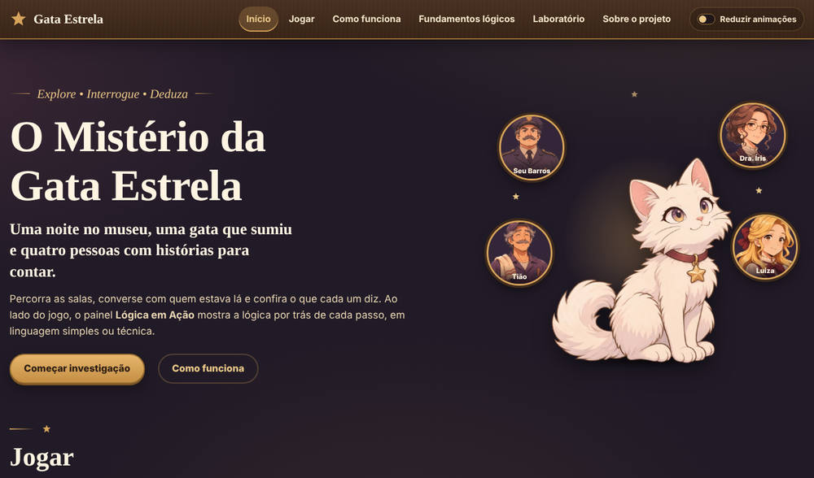

## O jogo em imagens
Você é a **Detetive Moraes**. Dona Helena perdeu a gata Estrela do museu; você investiga pistas, ouve depoimentos e confere tudo com o motor de inferência. Ao lado do jogo, o painel **Lógica em Ação** mostra, em cada passo, o que o motor fez de verdade.

| | |
|---|---|
| 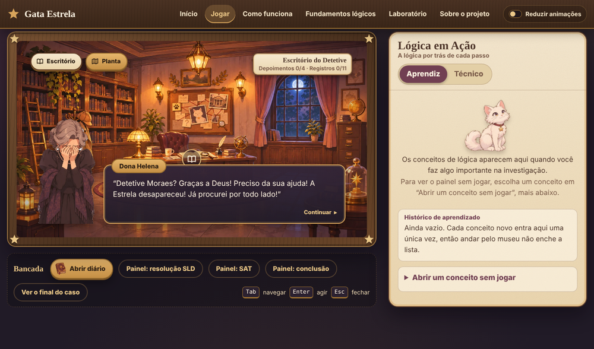 **Abertura:** o caso chega ao escritório da detetive. | 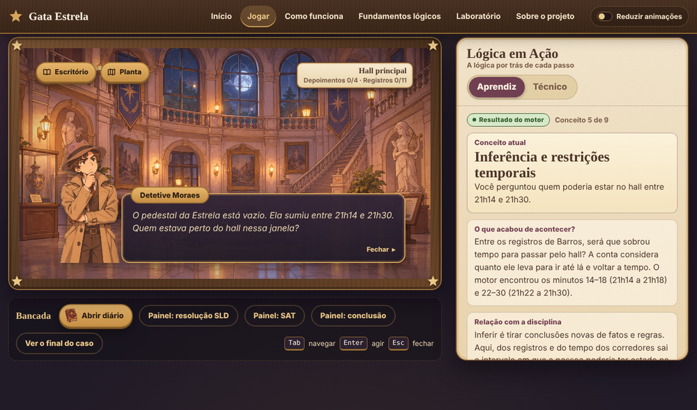 **Hall principal:** o pedestal vazio e, ao lado, o painel "Lógica em Ação". |
| 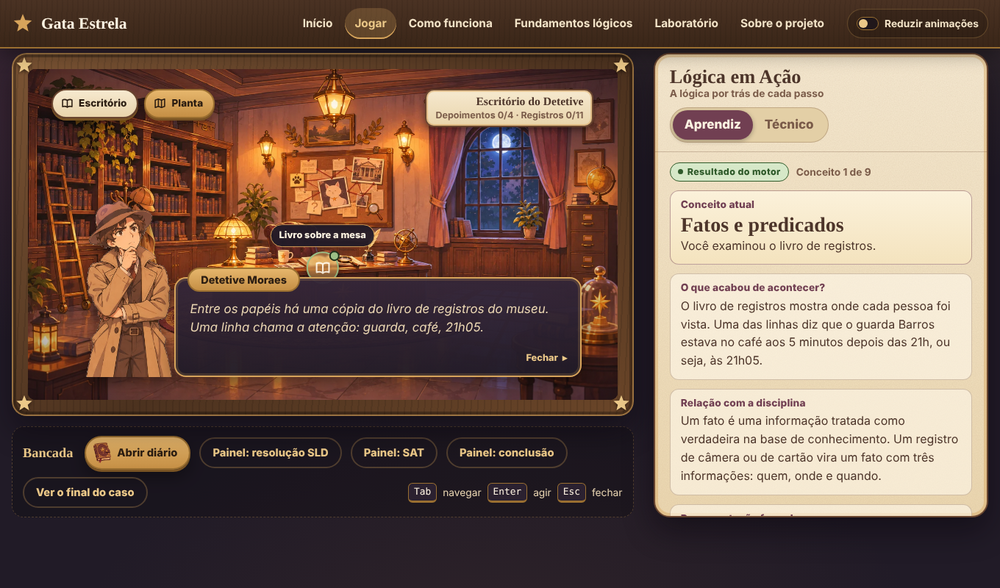 **Pista:** o livro de registros vira fatos do motor. | 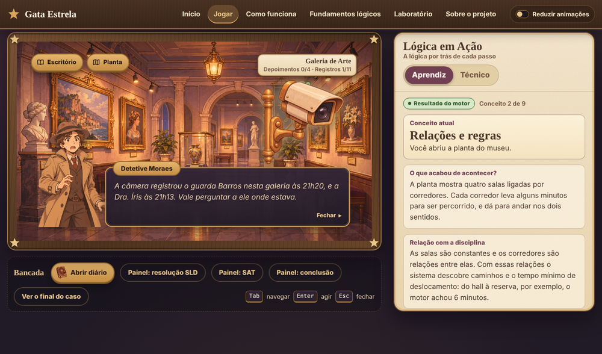 **Câmera da galeria:** mais um registro (com `fonte`). |
| 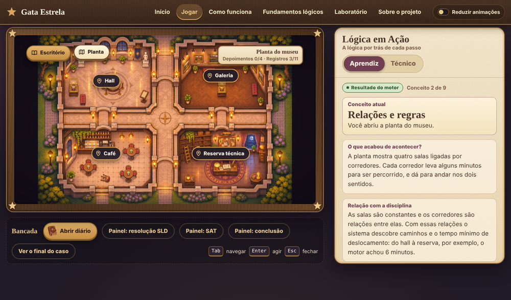 **Planta:** salas e tempos de deslocamento usados na modelagem. | 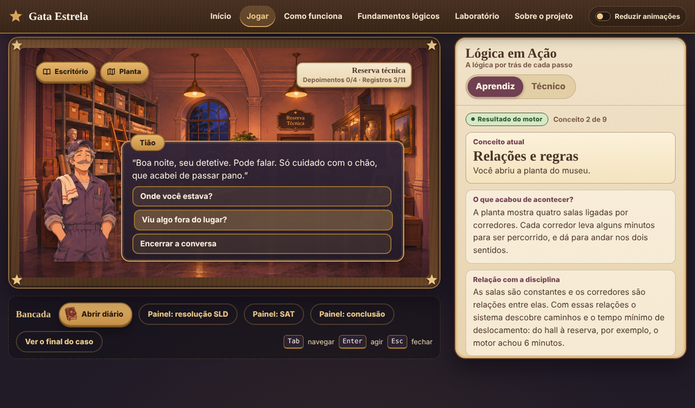 **Conversa com o Tião:** depoimentos são hipóteses, não fatos. |
| 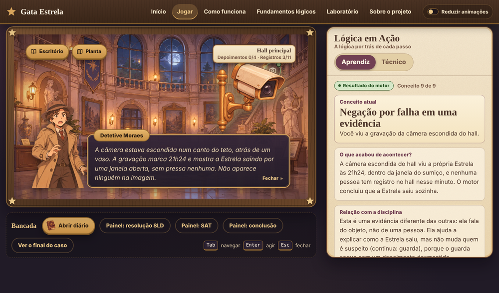 **Câmera escondida do hall:** vira um `avistamento/4` no motor. | 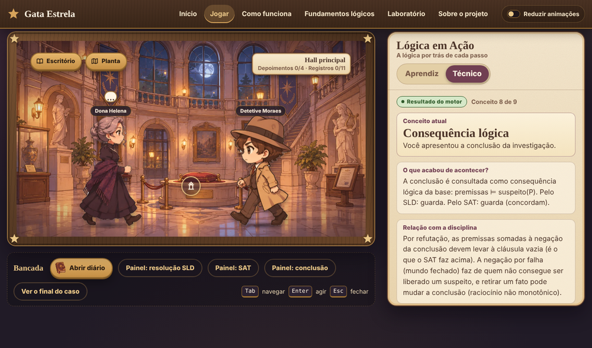 **Conclusão (modo Técnico):** quem permanece suspeito. |
| 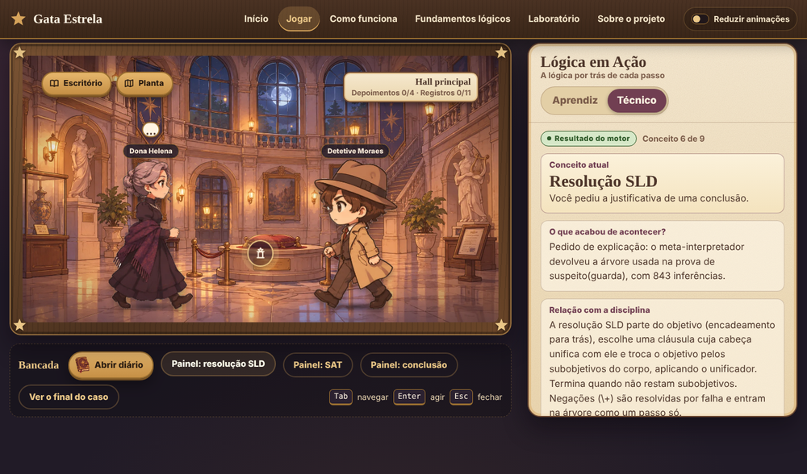 **Prova SLD:** árvore de inferência gerada pelo meta-interpretador. | 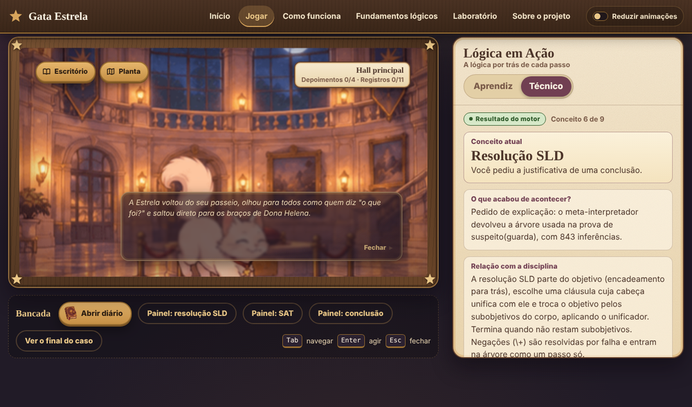 **A Estrela volta:** final narrativo (cenário animado). |

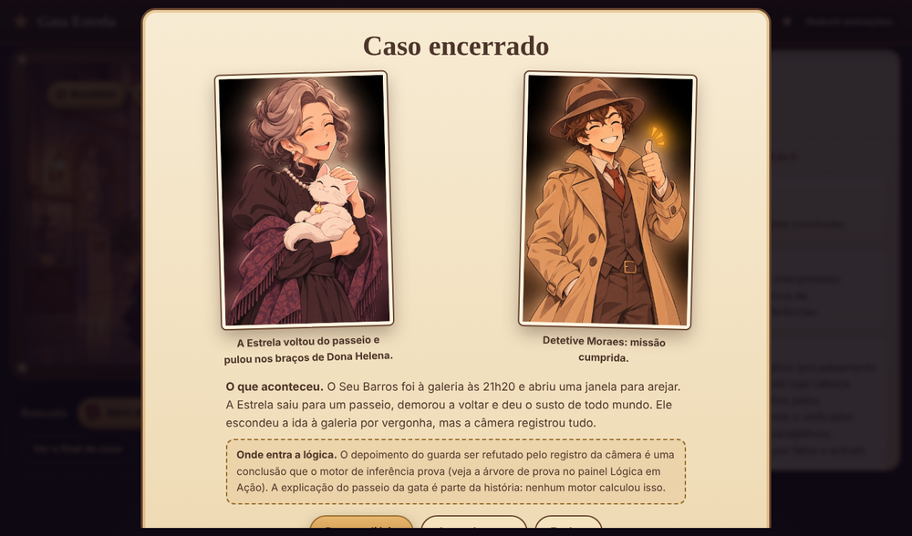

### Outras seções do site
| | |
|---|---|
| 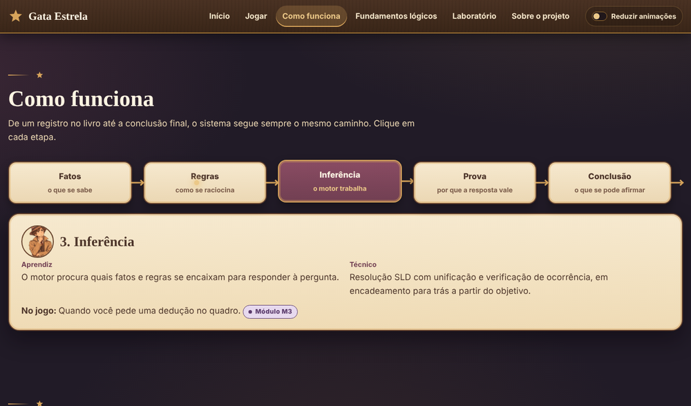 **Como funciona:** fatos, regras, inferência, prova e conclusão. | 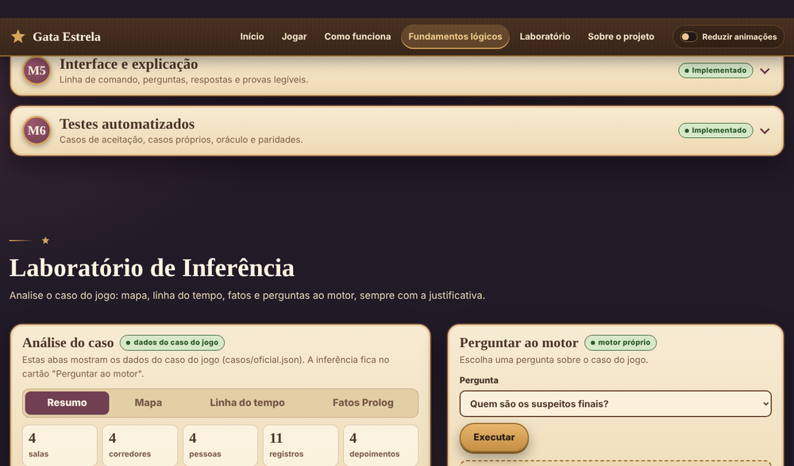 **Laboratório:** perguntas ao motor sobre o caso oficial. |
| 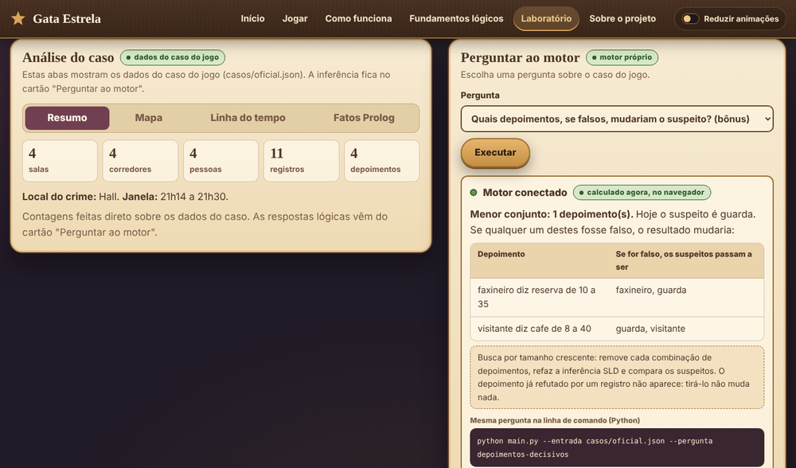 **Bônus:** quais depoimentos, se falsos, mudariam os suspeitos. | 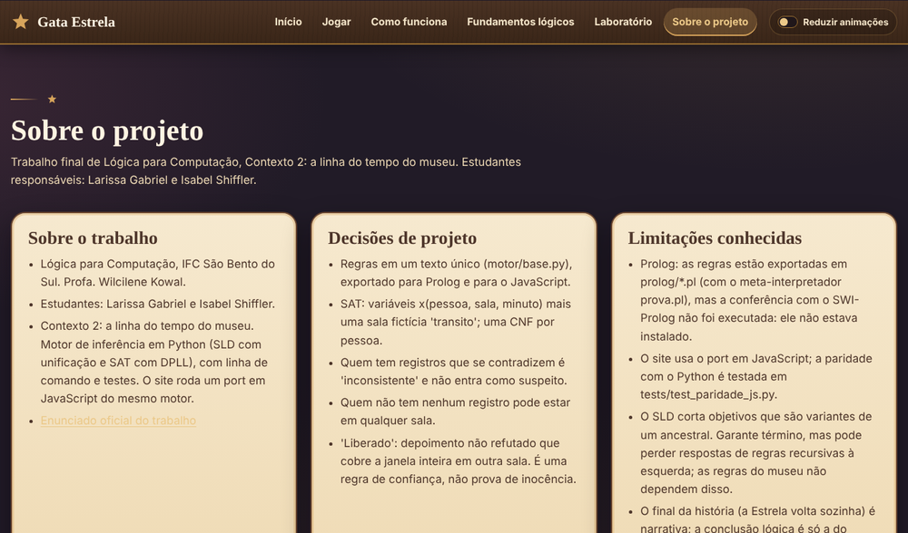 **Sobre o projeto:** decisões, limitações e testes. |

### No celular
<p>
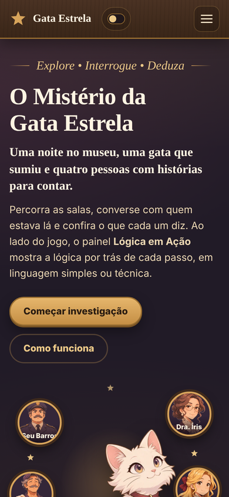
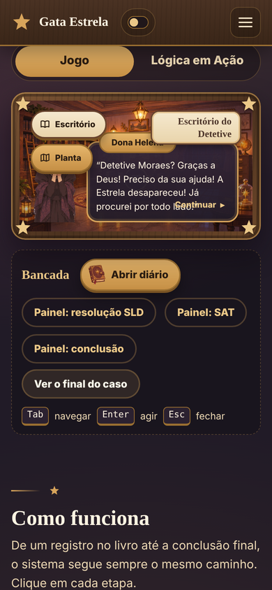
</p>

> As capturas foram geradas automaticamente com Playwright a partir do site real; os números e provas que aparecem vêm do motor, não de texto fixo.

## Como testar
```bash
# 1) o site (funciona sem servidor): dois cliques em index.html
# 2) a linha de comando
python main.py --entrada casos/oficial.json --pergunta quem-levou
python main.py --entrada casos/oficial.json --pergunta prova --objetivo "refutado(guarda, S, De, Ate)"
python main.py --entrada casos/oficial.json --pergunta sat
python main.py --entrada casos/oficial.json --pergunta dimacs --pessoa guarda --saida guarda.cnf
python main.py --help                       # todas as perguntas (distancia, onde-pode, refutados, consulta, depoimentos-decisivos, ...)
# 3) os testes
python -m pytest tests
```
Só biblioteca padrão do Python 3 (o pytest é a única dependência, e só para os testes). O teste de paridade com JavaScript usa `node`; o de paridade com Prolog usa `swipl`. Se um deles não estiver instalado, o teste é **pulado e aparece como "não executado"**.

## Organização
| Pasta | O que tem |
|---|---|
| `motor/` | **motor canônico em Python**: `termos.py` (unificação), `sld.py` (SLD, meta-interpretador), `base.py` (regras + fatos do JSON), `sat.py` (CNF, DPLL, DIMACS), `consultas.py`, `referencia.py` (oráculo independente) |
| `main.py` | linha de comando |
| `casos/` | 12 casos de entrada em JSON (oficial, do enunciado "sem registro do guarda" e 10 próprios) |
| `prolog/` | regras e casos em Prolog, gerados de `motor/base.py` (`tools/gerar_prolog.py`) |
| `tests/` | pytest: unificação, SLD, SAT, casos, aleatórios × oráculo, SAT × SLD, Python × JS, Prolog × Python |
| `docs/` | `modelagem.md` (M1), `ARQUITETURA.md`, `PROGRESSO.md` |
| `index.html`, `css/`, `js/`, `assets/` | o site; `js/motor/` é o **port em JavaScript** do motor, usado no navegador; `js/engine/adaptador.js` liga página e motor |
| `data/` | conteúdo do site; `testes.js` e `saidas-cli.js` são **gerados** executando o pytest e a CLI de verdade |
| `tools/` | scripts de apoio (empacotar dados, gerar Prolog, gravar testes e saídas da CLI, montar o artifact) |

## Honestidade sobre o que foi executado
- O motor Python é o **canônico**. Como um site estático não roda Python, o site usa um port em JavaScript; `tests/test_paridade_js.py` confere que, em todos os casos, ele dá as **mesmas respostas, o mesmo número de inferências, o mesmo SAT e o mesmo DIMACS**.
- **A conferência com Prolog de verdade (SWI-Prolog) não foi executada**: o programa não estava instalado onde o projeto foi desenvolvido. O teste existe (`tests/test_prolog.py`) e roda sozinho quando `swipl` estiver disponível; os arquivos `prolog/*.pl` já estão prontos.
- A tabela de testes do site vem de `data/testes.js`, gravado pelo pytest (`python tools/exportar_testes.py`). Nada é preenchido à mão.
- O final da história (a Estrela volta sozinha depois de passear) é **narrativo**; a conclusão *lógica* é só "quem permanece suspeito com os dados recebidos".

## Decisões de modelagem
- Registros são fatos confiáveis; depoimentos são hipóteses. `refutado/4`: um registro da mesma pessoa em outra sala dentro do intervalo.
- `liberado/1`: depoimento não refutado que cobre a janela inteira em sala diferente da do crime. `suspeito/1`: registros coerentes, não liberado e com tempo de estar no local do crime na janela.
- Registros que não cabem no mapa (`registro_impossivel/5`) marcam a pessoa como **inconsistente**: é dado a conferir, não acusação.
- SAT: variáveis `x(pessoa, sala, minuto)` + sala fictícia `transito`; sem Tseitin (as restrições já são cláusulas). Consistência com núcleo mínimo, consequência por refutação, contagem projetada (com teto) e DIMACS.
- O SLD corta objetivos que são variantes de um ancestral: garante término, mas sem tabulação pode perder respostas de regras recursivas à esquerda (as regras do museu não dependem disso).

- **Câmeras:** as câmeras entram como `fonte` dos registros e como `avistamento/4`; as regras `acompanhada/2` e `saiu_sozinha/3` usam isso e **não alteram a lista de suspeitos**.
- **Bônus (real):** `depoimentos_decisivos` calcula o menor conjunto de depoimentos que, se falsos, muda os suspeitos (`--pergunta depoimentos-decisivos`).

## Site
Abra `index.html`. As fontes vêm do Google Fonts; sem internet o site usa fontes de reserva.
Depois de editar `assets/manifest.json` ou `casos/*.json`: `python3 -I tools/empacotar_dados.py`. Depois de mudar `motor/base.py`: `python3 tools/gerar_prolog.py`.
